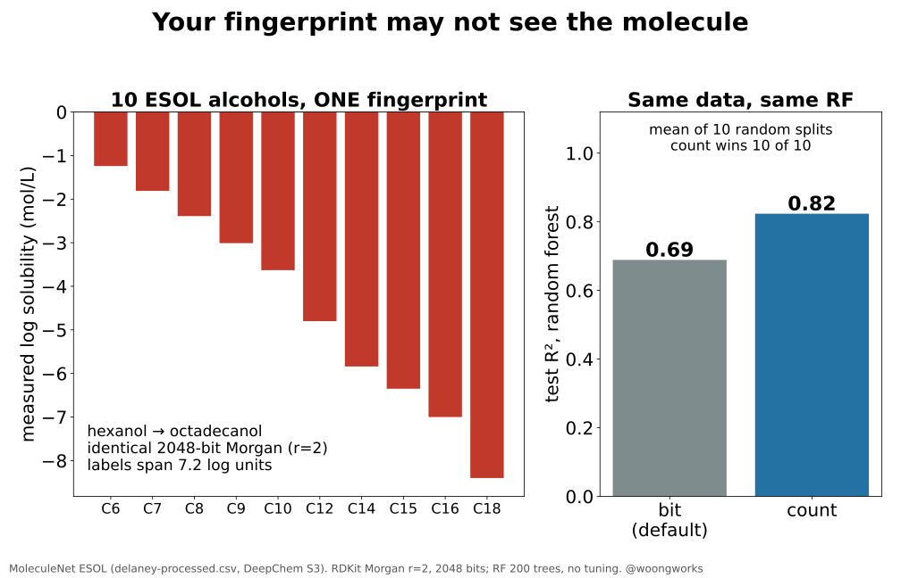

# Fingerprint blind spot

This folder measures how often a default Morgan fingerprint (radius 2, 2048 bits) gives *different* molecules the *same* feature vector on public MoleculeNet sets, and what that does to a default random-forest pipeline.



## Key numbers

Taken from the JSON in this folder (means rounded to three decimals; full precision is in the files):

- ESOL, random forest, 10 random 80/10/10 splits: bit-fingerprint test R² **0.689** vs count-fingerprint R² **0.824**. Count was better on **10/10** splits (`fix_r2.json`: 0.6888885727839474 vs 0.8235874736820928).
- 10 ESOL alcohols, hexanol to octadecanol, share one Morgan r=2 2048-bit vector. Their measured solubility spans **7.2** log units (`esol_alcohol_collision.csv`: −1.24 to −8.40, span 7.16).
- BACE: **31** collision groups of distinct structures, **28** of them stereo-only. Median pIC50 gap inside a group: **1.27**; max: **3.03** (`fp_fix_stats.json` bit fingerprint: 31 groups, median 1.2671713000000002, max 3.0314083; the 28 stereo-only groups are the `flat_dup_groups` count in `dup_stats.json`). Count + chirality cuts the 31 groups to **9** (`fp_fix_stats.json`, `count_r2_2048_chiral`).

## How to run

Needs RDKit, scikit-learn, pandas, numpy, and matplotlib (same stack as the repo root `requirements.txt`). CPU only; the two random-forest scripts take a few minutes.

```bash
cd fingerprint-blind-spot
bash download_data.sh   # MoleculeNet CSVs from DeepChem S3, SHA-256 checked
python3 dups.py         # writes dup_stats.json and parsed_*.csv
python3 fix.py          # writes fp_fix_stats.json
python3 esol_fix.py     # writes fix_r2.json
python3 fpdup.py        # writes fp_twin_stats.json
python3 fig3.py         # writes esol_alcohol_collision.csv, fingerprint-blind-spot.png and .svg
```

`download_data.sh` checks these SHA-256 hashes:

```
8c06a76f0c6487d29ab0f903e6a7a7139f189ab3c1178f159c8be8964602f189  delaney-processed.csv
ab5895d914ee87cb563bd7b9611e869527bba45bec6b014d34dc495a0f9dcb72  SAMPL.csv
aed41590cb30609d51d8e08ad3ff06495a76e80e211358801f596b10da69bacd  Lipophilicity.csv
f3fb9ce90bada3e2bd6148b0df13f8f8145a357bf87df0dd5b391ede974fc737  bace.csv
d07a38487aeac5cee5508413e468043ef3097451d2a112701c2d60be9ec6b662  BBBP.csv
```

The datasets remain under their own terms and are not stored in the repository.

## Caveats

Random forest only, no hyperparameter tuning, small sets, 10 seeds. Part of the ESOL gain is that counts make chain length visible, and size matters for solubility.

## Credit

Pat Walters pointed out the BACE stereoisomer sets in 2023: [We Need Better Benchmarks for Machine Learning in Drug Discovery](https://practicalcheminformatics.blogspot.com/2023/08/we-need-better-benchmarks-for-machine.html). What is new here is measuring what those collisions do to a default fingerprint + random-forest pipeline.
